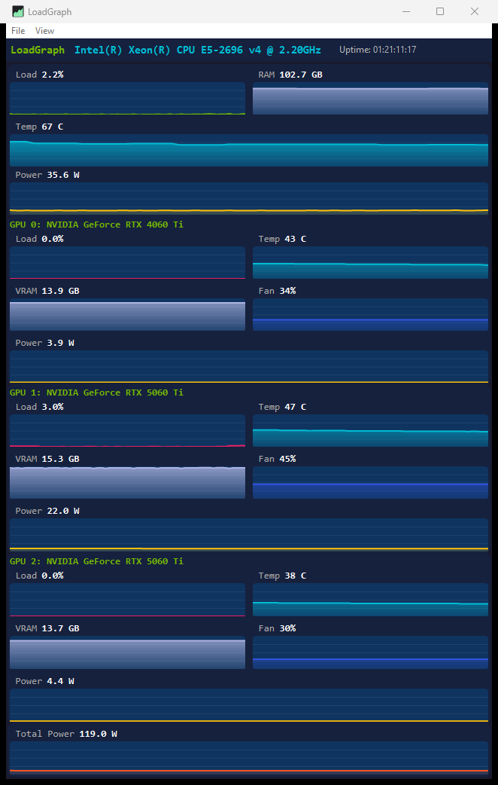
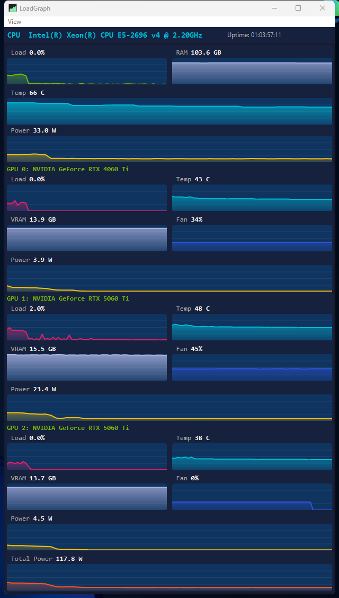
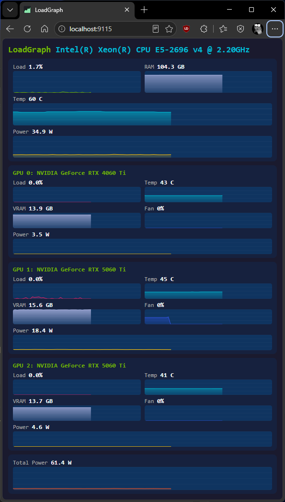
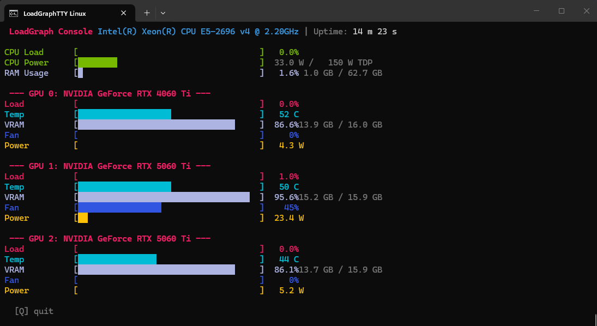
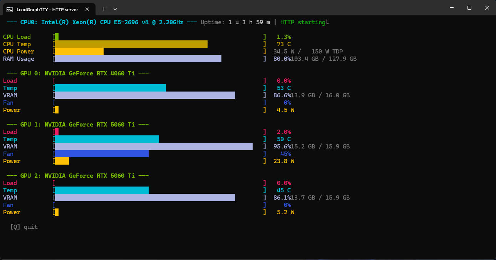

# LoadGraph

Real-time system resource monitor tailored for visual oversight of local LLM workloads. Windows 7 SP1/8.1/10/11 + Linux (Ubuntu 22.04 / Linux Mint). One graph per metric, single window, no tabs, no scrollbar.

[Версия на русском языке](README_rus.md)

**Version:** 1.0.0

## Download

A pre-built 64-bit Windows binary is available at [andyk.ru/files/LoadGraph.zip](https://andyk.ru/files/LoadGraph.zip). Extract and run `LoadGraph.exe` (the build produces `build\bin\Release\LoadGraphGUI.exe`) — no installation required. The binary is self-contained: the C runtime is linked statically, so *no* "Visual C++ Redistributable" has to be installed and nothing is copied next to the executable. Place a WinRing0-compatible `.sys` file next to the executable for CPU temperature monitoring (see [Driver](#driver)).

> **Windows 7 note:** the x64 build runs on Windows 7 SP1 and later. Windows 7 RTM (no service pack) is not supported, and the console version (`LoadGraphTTY`) relies on ANSI escape sequences that the Windows 7 console does not understand - use the GUI there.

## Why this exists

Standard GPU monitoring tools fall short when you need to watch multiple cards at once — exactly the situation when running local LLMs:

| Tool | Problem |
|---|---|
| **Windows Task Manager** | Shows only the first GPU. The second card shows incorrect GPU Load value.|
| **NVIDIA App** | Separate tab per GPU. You have to switch views to see the other card. Simultaneous multi-GPU view is impossible. |
| **nvidia-smi** | Console text. Fine for scripts, useless for visual monitoring of LLM inference. |
| **HWInfo / MSI Afterburner** | Heavy utilities full of noise. Afterburner overlay covers your LLM window. |

LoadGraph solves this: **all metrics for all GPUs are visible at once in a single window**, alongside CPU and RAM. Full picture, no switching.

## What it shows

- **Header** — CPU model name on the left, system uptime on the right (the web dashboard uses the same header)
- **CPU Load (%)** — overall processor utilization (`/proc/stat` delta-method on Linux, PDH `\\Processor(_Total)\\% Processor Time` on Windows)
- **RAM Usage (GB)** — used memory with adaptive Y-axis
- **GPU Load (%)** — per-GPU utilization (one section per detected NVIDIA or AMD GPU, titled with the card name; each section contains Load, VRAM, Temperature, Fan and Power graphs)
- **VRAM (GB)** — video memory used on each card
- **Temperature (°C)** — GPU temperature; CPU temperature on Windows via MSR (IA32_THERM_STATUS 0x19C, per-family Tjmax: 84 for Haswell-E/EP, 85 for Broadwell-EP, 100 for Skylake and newer); red alarm line above 80°C
- **Fan (% / RPM)** — GPU fan in percent (or RPM fallback), CPU fan in RPM (when sensor is available)
- **GPU Power (W)** — per-card power draw (NVIDIA: NVML `nvmlDeviceGetPowerUsage`; AMD: ADL2 Overdrive6 on Windows, hwmon `power1_average` on Linux)
- **CPU Power (W)** — real RAPL counter on Linux, or LHM/OpenHardwareMonitor WMI sensor on Windows, or idle-floor estimate as last fallback
- **Total Power (W)** — CPU + all GPUs summed; fixed 0..1000 W scale with 5 ticks
- **Uptime** — system boot time displayed as `YY:MM:DD HH:MI:SS` or `<N> s` for fresh boots

## Screenshots

### Windows



### Linux / WSL2

Works on native Linux and inside WSL2 thanks to the GPU-PV bridge (NVML exposed at `/usr/lib/wsl/lib/libnvidia-ml.so.1`). NVAPI is Windows-only; Linux uses NVML exclusively. AMD cards on Linux are read directly from the `amdgpu` driver — sysfs (`gpu_busy_percent`, `mem_info_vram_*`) and hwmon (`temp1_input`, `power1_average`, `fan1_input`, `freq1_input`) — without any external tools or ROCm libraries.



### Web Dashboard (HTTP Server)

Enable with `"http_enabled": true` in `loadgraph.cfg` or toggle at runtime via **File -> HTTP server (port N)** (`Ctrl+H`) in the GUI — the choice is saved to `loadgraph.cfg`:

- **`GET /`** — responsive HTML dashboard with live charts, mirrors the GUI layout. No dependencies — pure vanilla JS + Canvas.
- **`GET /api/metrics`** — JSON endpoint exposing all current metrics (CPU load/temp/power, RAM, per-GPU stats, storage).
- **`GET /favicon.ico`** — embedded favicon.

All endpoints are protected with **HTTP Basic auth**. Login and password live in `loadgraph.cfg` as `"http_user": "load"` and `"http_pass": "graph"` (defaults `load` / `graph`). The browser prompts for credentials on the first visit; set `"http_auth": false` (or `"http_user": ""`) to serve the dashboard without a login. Credentials are captured when the server starts, so after editing them restart the server (`Ctrl+H` toggle or app restart). The password is stored in plaintext in the config file - protect it with user/profile permissions.

**Invalid requests only** are recorded in a separate access log `loadgraph_http.log` (same per-user directory): connections that sent no request bytes (port scanners), `401` auth failures and `404` unknown paths. The file is created lazily on the first logged event and is never truncated - app restarts append to it. Each line carries the client `IP:port`, method, path, status code and the raw request text on one line (control bytes escaped, length-capped, the `Authorization` header masked as `***`). Valid responses - including the dashboard's per-second `/api/metrics` polls - are never logged, so in normal use the file is not even created. Disable it with `"http_log": false`.

Works on both Windows and Linux. The dashboard auto-refreshes every second via polling.



## Console Application (LoadGraphTTY)

A terminal-only monitoring tool — zero wxWidgets dependency, runs in any UTF-8-capable terminal.

```
LoadGraphTTY [-port N]
  -port N   Start built-in HTTP server on port N (serves the web dashboard)
  -h        Show help
```

Features:

- **HTop-like layout** — CPU Load and RAM Usage with horizontal progress bars (width scales with the console, 20..60 cells)
- **Per-GPU metrics** — Load, Temperature (color-coded: green/yellow/red), VRAM, Fan, Power
- **Colored output** — reads colors from `loadgraph.cfg`; Windows uses WinAPI console colors, Linux uses ANSI escape sequences
- **UTF-8 progress bars** — `█` block characters for the filled part, plain spaces for the empty part, on both platforms
- **Optional HTTP server** — pass `-port 9115` to serve the web dashboard alongside the TTY display
- **File logging** — writes `loadgraph.jsonl` snapshots to the config directory when `"log_file": true` in config (one snapshot every 5 s, one file per run: the first snapshot rewrites it); the same writer runs in the GUI build too

### Screenshots

#### Linux / WSL2



#### Windows



## Requirements

### Windows

- Visual Studio 2022 (MSVC) — required on Windows (SEH extensions and MSVC-style compiler flags are used; MinGW is not supported)
- wxWidgets 3.2 static build linked against the static CRT (`C:/wxWidgets`, built into `build_static_mt`, see [Building](#building)). Override with: `-DWX_WIN_BUILD_DIR=<lib dir>` and `-DWX_CONFIG_PATH=<root>`
- NVIDIA driver (for NVIDIA GPU metrics; CPU/RAM work without a GPU)
- AMD GPU metrics need the AMD display driver installed (Adrenalin or legacy Catalyst) — `atiadlxx.dll` / `atiadlxy.dll` is loaded dynamically, no extra setup. If ADL cannot enumerate the adapter, a DXGI fallback still reports the model name and VRAM (see [Known limitations](#known-limitations))
- **CPU temperature** requires one of:
  - A WinRing0-compatible kernel driver (`.sys`) placed next to the executable — see [Driver](#driver) below
  - Or direct `rdmsr` access (works on some systems where HVCI / Memory Integrity is off and the CPU does not block user-mode MSR reads)

### Linux

- gcc 13+ or clang
- wxWidgets 3.2: `sudo apt install libwxgtk3.2-dev` (or set `$WX_CONFIG`, or point `$WXSTATIC_ROOT` at your own static build — see [Building](#building))
- NVIDIA driver + `libnvidia-ml` for GPU metrics (`nvidia-smi` must work)
- WSL2: GPU-PV bridge exposes NVML automatically, no extra setup needed
- AMD GPU: `amdgpu` driver must expose the card in `/sys/class/drm` (native Linux with the card visible; plain WSL2 does not expose AMD cards unless GPU partitioning/passthrough is configured). Model names of cards bound to the legacy `radeon` driver are read from the distro `pci.ids` database (`/usr/share/misc/pci.ids` from `pciutils`, or `/usr/share/hwdata/pci.ids` from `hwdata`)

## Driver

CPU temperature on Windows is read from IA32_THERM_STATUS (MSR 0x19C). This requires a kernel-mode driver because user-mode `rdmsr` is blocked by default on modern Intel CPUs.

### Shipping the driver

Place a WinRing0-compatible `.sys` file next to the executable before distribution. Supported names (checked in order):

```
hwinterfacex64.sys
inpoutx64.sys
WinRing0x64.sys
```

The app will also detect any of three already-registered well-known services and reuse them without needing the `.sys` file: `WinRing0_1_2_0` (RealTemp / LibreHardwareMonitor), `hwinterfacex64`, or `inpoutx64`.

### Installing the driver via UAC

When no backend is available but a `.sys` file is present, LoadGraph shows a one-time prompt:

> "Install kernel driver for CPU temperature monitoring?"

Accepting the prompt elevates the process via `ShellExecute(runas)`, runs the built-in helper (`--install-driver`), which registers and starts the service — leaving it installed. With the current `SERVICE_DEMAND_START` type the service survives within the current session without further UAC prompts, but the first launch after a reboot will require elevation again. Set the service to `AUTO_START` if you want it to load automatically at boot. Declining or cancelling falls back gracefully to WMI / N/A for temperature.

> **Note:** WinRing0 is on Microsoft's Vulnerable Driver Blocklist. Windows Defender may delete the `.sys` file automatically. If this happens, add an exclusion for the LoadGraph executable directory in Windows Security → Virus & threat protection → Manage settings → Exclusions. This is the same workaround used by RealTemp and HWiNFO communities.

### Direct rdmsr fallback

On systems where HVCI / Memory Integrity is disabled and the CPU does not block user-mode MSR access, LoadGraph falls back to `__readmsr()` without any driver. Temperature will show correctly even in this case. If the intrinsic raises an exception (privilege violation), the app silently falls back to WMI.

## Building

### Windows (MSVC)

LoadGraph links the C runtime statically (`/MT`), so **every** static library it links
must be built with the static CRT as well - including wxWidgets. Mixing `/MT` objects
with `/MD`-built libraries would embed a second CRT in the process (two heaps, two
locale states) and would re-introduce the `VCRUNTIME140.dll` dependency. Build the wx
libraries once like this:

```powershell
cmake -S C:\wxWidgets -B C:\wxWidgets\build_static_mt -G "Visual Studio 17 2022" -A x64 `
      -DBUILD_SHARED_LIBS=OFF -DCMAKE_MSVC_RUNTIME_LIBRARY=MultiThreaded
cmake --build C:\wxWidgets\build_static_mt --config Release `
      --target wxbase wxcore wxpng wxjpeg wxtiff wxzlib wxregex
```

Then build the application:

```powershell
cd build
cmake .. -G "Visual Studio 17 2022" -A x64
cmake --build . --config Release
.\bin\Release\LoadGraphGUI.exe
```

`CMakeLists.txt` picks the libraries up from `C:\wxWidgets\build_static_mt\lib\vc_x64_lib`
(`-DWX_WIN_BUILD_DIR=<dir>` and `-DWX_CONFIG_PATH=<root>` override that) and stops with a
message telling you to run the commands above if they are missing. Only `Release` is
supported for the GUI: a `Debug` build needs the debug wx libraries
(`wxmsw32ud_core.lib` etc.), which the commands above do not produce.

The Windows targets pin `_WIN32_WINNT=0x0601` and link with `/SUBSYSTEM:WINDOWS,6.01` /
`/SUBSYSTEM:CONSOLE,6.01`, so the SDK headers reject any API newer than Windows 7 and the
PE header declares Windows 7 as the minimum OS.

### Linux

```bash
mkdir -p build_linux && cd build_linux
cmake ..
make -j$(nproc)
./bin/LoadGraphGUI
```

Override wx-config path:

```bash
WX_CONFIG=/opt/wx/3.2/bin/wx-config cmake ..
```

Use a self-built static wxWidgets instead (this is what the WSL2 setup does, because
the Ubuntu `libwxgtk3.0-1` package is built without `wxUSE_GRAPHICS_CONTEXT` and
`graph_panel.cpp` cannot compile against it). `WXSTATIC_ROOT` is read from the
environment and must point at a directory holding `include/`, `include/gtk3-unicode-static-3.2/`
and the `libwx_*-3.2.a` archives:

```bash
WXSTATIC_ROOT=$HOME/wxstatic cmake ..
```

`WXSTATIC_ROOT` wins over `wx-config`, and setting it clears any stale
`WX_CONFIG_EXECUTABLE` entry left in the CMake cache — without that, re-running
`cmake` after a `CMakeLists.txt` edit would silently switch the build back to the
system wx headers.

## Configuration

All settings are stored in a single `loadgraph.cfg` JSON file, in the same per-user directory on both platforms (created on the first run):

- **Windows**: `%USERPROFILE%\.config\loadgraph\loadgraph.cfg`
- **Linux**: `$XDG_CONFIG_HOME/loadgraph/loadgraph.cfg` (defaults to `~/.config/loadgraph/loadgraph.cfg`)

`loadgraph.log` (GUI) and `loadgraph.jsonl` (written by both the GUI and the console build when `"log_file": true`) are written to that same directory — nothing is placed next to the executable. Both are recreated on every start: the previous run's contents are discarded. When the HTTP server runs with `"http_log": true`, `loadgraph_http.log` (access log: client IPs, invalid request texts) is written there too.

```jsonc
{
  "http_port": 9115,
  "http_enabled": false,
  "http_user": "load",
  "http_pass": "graph",
  "http_auth": true,
  "http_log": true,
  "log_file": false,
  "superio_fan": false,
  "superio_warn_ok": false,
  // Window position and size — (0,0,0,0 = let OS decide)
  "window_x": 100,
  "window_y": 100,
  "window_w": 640,
  "window_h": 720,
  "colors": {
    "cpu_load": "76B900", "cpu_temp": "00bcd4", "cpu_power": "ffc107",
    "ram": "AEB4E1", "gpu_load": "e91e63", "gpu_temp": "00bcd4",
    "gpu_vram": "AEB4E1", "gpu_fan": "3154E1", "gpu_power": "ffc107",
    "total_power": "ff5722"
  },
  "backgrounds": {
    "page": "1a1a2e", "section": "16213e", "chart": "0f3460"
  },
  // View menu visibility state (persisted across sessions)
  "view_menu": { "cpu_load": true, "ram": true, "gpu_temp": false, ... }
}
```

`superio_fan` (Windows only) turns on the direct Super I/O tachometer read described in
the limitations section; the same switch is available at runtime under **View -> CPU Fan
via Super I/O**, which also persists the value. `superio_warn_ok` records that the one-time
warning about direct port access has been confirmed, so the dialog is never repeated. On
Linux the CPU fan always comes from `/sys/class/hwmon` and neither key has any effect.

## Architecture

```
src/
  main.cpp                  # entry point, platform guards, SIGSEGV handler (Linux),
                            # --install-driver elevated helper mode, crash.log placement
  console_app.cpp           # LoadGraphTTY — htop-like terminal UI + optional HTTP server
  main_frame.{h,cpp}        # window: header + proportionally stretched graph rows, View menu toggle
  graph_panel.{h,cpp}       # custom wxPanel, rendering via wxGraphicsContext
  metrics_collector.{h,cpp} # base class: poll thread, 1000 ms interval, condition_variable stop
  cpu_monitor.{h,cpp}       # Windows — PDH load, WMI thermal probe, MSR driver init, LHM/WMI power sensor, Super I/O (NCT679x) fan probe
  cpu_monitor_linux.cpp     # Linux — /proc/stat (delta-method), /sys/class/thermal, RAPL power, hwmon CPU fan
  ram_monitor.{h,cpp}       # Windows — GlobalMemoryStatusEx
  ram_monitor_linux.cpp     # Linux — /proc/meminfo
  gpu_monitor.{h,cpp}       # Windows — NVML primary + NVAPI fallback (GetDynamicPstates)
  gpu_monitor_linux.cpp     # Linux — dlopen libnvidia-ml.so.1 (real symbol names)
  amd_monitor.{h,cpp}       # AMD GPU — ADL2 (dynamic atiadlxx.dll) + DXGI VRAM on Windows, amdgpu sysfs/hwmon on Linux
  ring0_msr.{h,cpp}         # WinRing0 DLL / kernel driver back-end, UAC elevation helpers, byte port I/O
  msr_sensor.{h,cpp}        # MSR temperature reader: Tjmax decode, EnsureDriver prompt
  power_table.{h,cpp}       # Static TDP table for Intel/AMD CPUs and NVIDIA GPUs (substring match)
  theme.{h,cpp}             # Windows — Registry AppsUseLightTheme, dark palette cache
  theme_linux.cpp           # Linux — GTK_THEME, XDG_CURRENT_DESKTOP, gsettings 30 s cache
  app_config.h/cpp          # AppConfig struct + JSON parser/emitter for loadgraph.cfg
  http_server.{h,cpp}       # cross-platform HTTP server + web dashboard HTML
  logger.{h,cpp}            # file logger (loadgraph.log in the config directory, recreated on each start; stderr fallback on fopen fail)
  platform.h                # PLATFORM_WINDOWS / PLATFORM_LINUX, ReadFileToString, mkdir -p helper
```

### Key design decisions

- **MetricsCollector** uses a `condition_variable` for stop — thread exits in milliseconds, not seconds.
- **SEH protection** around `rdmsr` and WMI calls prevents crashes on systems where these APIs misbehave.
- **Single config file**: window position/size, view menu state, colors, HTTP settings — all in one `loadgraph.cfg`. No separate files.
- **Driver lifecycle**: `Open()` tries DLL first, then kernel device, then known service, then registers from `.sys`. `Close()` does *not* stop or delete services — the driver stays installed across runs (the DEMAND_START service survives without requiring reinstall; the driver itself is loaded on first use).
- **UAC elevation** is one-shot: the helper process installs/starts the service and exits; subsequent non-elevated launches reuse the running service.
- **GPU TDP table** matches by substring with longer patterns first (e.g. `"RTX A4000"` before `"A40"`) to avoid shadowing.

## Known limitations

- **AMD GPU (Windows)** — metrics come from ADL2 (`atiadlxx.dll` / `atiadlxy.dll`, loaded dynamically): load and clocks from `ADL2_Overdrive6_CurrentStatus_Get` with `ADL2_Overdrive5_CurrentActivity_Get` as fallback, temperature (OD6 then OD5), fan (percent plus RPM) and VRAM size (`ADL2_Adapter_MemoryInfo2_Get`); VRAM usage always comes from DXGI `IDXGIAdapter3::QueryVideoMemoryInfo`, which is also the only VRAM source when ADL exposes no memory info. Power comes from `ADL2_Overdrive6_CurrentPower_Get` and stays N/A on drivers that do not implement it - typical for legacy Catalyst and pre-GCN cards. ADL exposes no power-limit value in watts, so the AMD power limit is always N/A on Windows. One physical card is listed once even though ADL reports a separate record per display output (an 8-output R9 280 yields 8 records with the same PCI bus/device/function). When ADL cannot enumerate the adapter at all, a DXGI fallback (`IDXGIAdapter3::QueryVideoMemoryInfo`) still shows the model name and VRAM, everything else N/A. The startup log makes a missing card unambiguous: `DIAG OS display ...` lists what the OS sees (`EnumDisplayDevicesA`), `DIAG ADL[...]` every ADL record with vendor id, PCI address and the `iPresent`/`iExist` flags, and the `AMD: ...` lines state how many physical adapters were recognized and which source is in use.
- **AMD GPU (Linux/WSL2)** - read from `amdgpu` sysfs/hwmon (`gpu_busy_percent`, `mem_info_vram_*`, `temp1_input`, `power1_average`, `power1_cap`, `fan1_input`, `pwm1`, `freq1_input`). Requires the card to be visible to Linux: WSL2 needs GPU partitioning/passthrough, plain WSL2 exposes only the NVIDIA vGPU bridge. Cards bound to the legacy `radeon` driver (TeraScale, GCN1) only get what `radeon_pm.c` registers in hwmon: temperature (`temp1_*`), fan PWM (`pwm1_*`) and GPU clock (`freq1_input`, already in Hz); fan RPM, VRAM, power and utilization are not exported by that driver at all and stay N/A. There the model name is resolved from the distro `pci.ids` database, because `product_name`/`pretty_name` are amdgpu-specific. SI cards (e.g. Tahiti / R9 280) can be switched to `amdgpu` with the kernel parameters `radeon.si_support=0 amdgpu.si_support=1` (SI firmware required), which unlocks load, VRAM and power without any code change. The startup log prints an `AMD diag:` block with the driver name, PCI IDs and every sensor file that is actually present.
- **Intel GPU** — not supported.
- **macOS** — not a target platform.
- **CPU temperature on Linux** — reads `/sys/class/thermal/thermal_zone0/temp`; many desktop boards expose no thermal zone, so N/A is common.
- **CPU fan (Windows)** — the Fan chart appears only when a sensor reports RPM; until then the RAM chart keeps the full width of its row. The CPU rows mirror the GPU section: Load + Temp, then RAM + Fan (RAM in the VRAM slot), then Power across the full width. Sources: the WMI thermal sensor probe, and, when the probe is switched on (`"superio_fan": true` in the config or **View -> CPU Fan via Super I/O**, which asks for confirmation the first time), a direct read of the Super I/O hardware monitor through WinRing0 port I/O. The chip is identified on the LPC config ports (0x2E / 0x4E), its hardware monitor logical device (0x0B) publishes the I/O window in config registers 0x60/0x61, that window is addressed at `base + 5` (index) and `base + 6` (data) with the bank selector at index 0x4E, and the 13-bit tachometer counters (0x4B0 and up) are decoded as `1350000 / count`. A window is accepted only when it answers with the Nuvoton vendor ID `0x5CA3` at `0x804F` / `0x004F`, which is what proves the firmware really decoded the monitor block; the config device ID (registers 0x20/0x21, masked with `0xFFF8`) only names the chip. Decoded parts: NCT6779D, NCT6791D, NCT6792D, NCT6793D, NCT6795D, NCT6796D/DR, NCT6797D, NCT6799D. Recognized but deliberately not decoded, because their tachometers live elsewhere: NCT6683D/6686D/6687D (EC page interface instead of the banked window), NCT6771F, NCT6776F (16-bit RPM registers), NCT610XD (different window) and NCT6701D (different register read order). The excluded parts are matched on the exact id/revision pair, the family only on the masked value, so an NCT6701D (0xD8/0x06) is never taken for an NCT6799D (0xD8/0x02). Only the config register that locks the monitor I/O space is written, no fan control or limit register is touched. Turning the probe off at runtime drops the value back to N/A instead of freezing the last reading; turning it on makes the collector identify the chip again. If the firmware keeps the monitor block undecoded the log names every window that was probed and the value stays N/A.
- **CPU fan (Linux)** — always on, no warning: the tachometers of the motherboard monitor chip are published by its kernel driver (`nct6775`, `it87`, `f71882fg`, `w83627hf`, `smsc47m1`, ...) as `/sys/class/hwmon/hwmonN/fanM_input`, already decoded into RPM, so LoadGraph only reads sysfs and never touches ports or needs root. The channel is picked once: a `fanM_label` naming the CPU connector wins (CPUFAN, CPU_FAN, CPU OPT), otherwise the first channel of a board monitor driver, otherwise the first channel that reports a running fan; graphics-card and NVMe hwmon devices are skipped so that the CPU row never repeats the GPU fan. A channel reading 0 is treated as "nothing connected". When the driver module is loaded later, the scan is retried every 30 s, and the startup log names the device and channel that was chosen (`CPU fan tachometer found: hwmon nct6779 channel 1 label cpufan`). Laptops whose fan is attached to an EC rather than to a Super I/O chip expose no hwmon tachometer, so the value stays N/A there.
- **HVCI / Memory Integrity** — if enabled in Windows Security, user-mode `rdmsr` is blocked and a kernel driver is required.
- **WinRing0 blocklist** — Microsoft actively blocks WinRing0 drivers on Windows 11 22H2+. Defender may delete the `.sys` file; add an exclusion for the LoadGraph directory if needed.
- **Virtualized systems (Hyper-V / VM)** — CPU temperature typically shows N/A. Standard WMI thermal classes (`MSAcpi_ThermalZoneTemperature`) are inaccessible from guest OS user mode, and `rdmsr` is blocked by the hypervisor. NVIDIA App works around this by running its backend (`nvcontainer.exe`) as LOCALSYSTEM, which has different WMI permissions — replicating this pattern requires elevation.

## License

MIT
