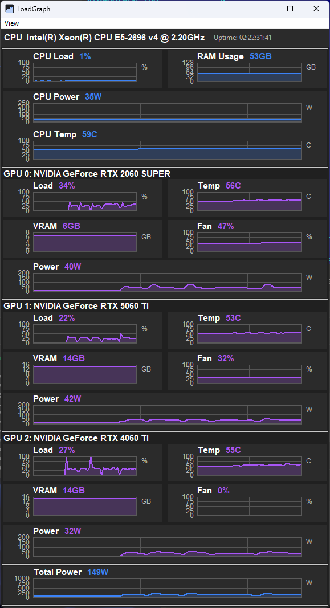
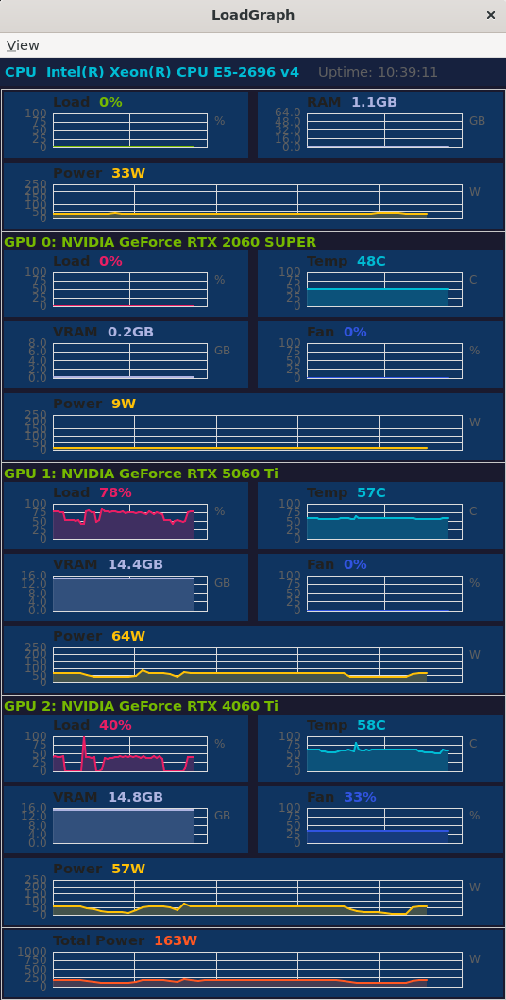
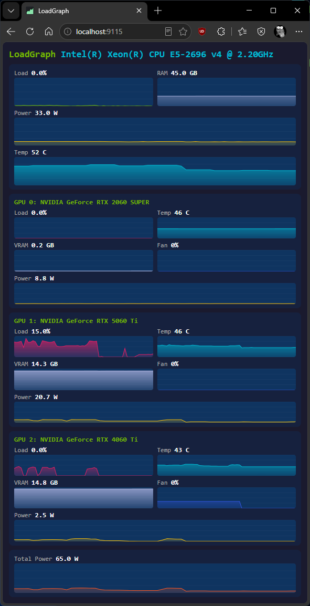

# LoadGraph

Real-time system resource monitor tailored for visual oversight of local LLM workloads. Windows 10/11 + Linux (Ubuntu 22.04 / Linux Mint). One graph per metric, single window, no tabs, no scrollbar.

[Версия на русском языке](README_rus.md)

**Version:** 1.0.0

## Download

A pre-built 64-bit Windows binary is available at [andyk.ru/files/LoadGraph.zip](https://andyk.ru/files/LoadGraph.zip). Extract and run `LoadGraph.exe` — no installation required. Place a WinRing0-compatible `.sys` file next to the executable for CPU temperature monitoring (see [Driver](#driver)).

## Why this exists

Standard GPU monitoring tools fall short when you need to watch multiple cards at once — exactly the situation when running local LLMs:

| Tool | Problem |
|---|---|
| **Windows Task Manager** | Shows only the first GPU. The second card shows incorrect GPU Load value.|
| **NVIDIA App** | Separate tab per GPU. You have to switch views to see the other card. Simultaneous multi-GPU view is impossible. |
| **nvidia-smi** | Console text. Fine for scripts, useless for visual monitoring of LLM inference. |
| **HWInfo / MSI Afterburner** | Heavy utilities full of noise. Afterburner overlay covers your LLM window. |

LoadGraph solves this: **all metrics for all GPUs are visible at once in a single window**, alongside CPU and RAM. Full picture, no switching.

## What it shows

- **CPU Load (%)** — overall processor utilization (`/proc/stat` delta-method on Linux, PDH `\\Processor(_Total)\\% Processor Time` on Windows)
- **RAM Usage (GB)** — used memory with adaptive Y-axis
- **GPU Load (%)** — per-GPU utilization (one section per detected NVIDIA card; each section contains Load, VRAM, Temperature, Fan and Power graphs)
- **VRAM (GB)** — video memory used on each card
- **Temperature (°C)** — GPU temperature; CPU temperature on Windows via MSR (IA32_THERM_STATUS 0x19C, per-family Tjmax: 84 for Haswell-E/EP, 85 for Broadwell-EP, 100 for Skylake and newer); red alarm line above 80°C
- **Fan (% / RPM)** — GPU fan in percent (or RPM fallback), CPU fan in RPM (when sensor is available)
- **GPU Power (W)** — per-card power draw from NVML `nvmlDeviceGetPowerUsage`
- **CPU Power (W)** — real RAPL counter on Linux, or LHM/OpenHardwareMonitor WMI sensor on Windows, or idle-floor estimate as last fallback
- **Total Power (W)** — CPU + all GPUs summed; fixed 0..1000 W scale with 5 ticks
- **Uptime** — system boot time displayed as `YY:MM:DD HH:MI:SS` or `<N> s` for fresh boots

## Screenshots

### Windows



### Linux / WSL2

Works on native Linux and inside WSL2 thanks to the GPU-PV bridge (NVML exposed at `/usr/lib/wsl/lib/libnvidia-ml.so.1`). NVAPI is Windows-only; Linux uses NVML exclusively.



### Web Dashboard (HTTP Server)

Enable with `"http_enabled": true` in `loadgraph.cfg`. The server starts on the configured port (default `9115`) in a detached thread:

- **`GET /`** — responsive HTML dashboard with live charts, mirrors the GUI layout. No dependencies — pure vanilla JS + Canvas.
- **`GET /api/metrics`** — JSON endpoint exposing all current metrics (CPU load/temp/power, RAM, per-GPU stats, storage).
- **`GET /favicon.ico`** — embedded favicon.

Works on both Windows and Linux. The dashboard auto-refreshes every second via polling.



## Console Application (LoadGraphTTY)

A terminal-only monitoring tool — zero wxWidgets dependency, runs in any UTF-8-capable terminal.

```
LoadGraphTTY [-port N]
  -port N   Start built-in HTTP server on port N (serves the web dashboard)
  -h        Show help
```

Features:

- **HTop-like layout** — CPU Load and RAM Usage with scrolling waveform history (60 samples, 40 columns)
- **Per-GPU metrics** — Load, Temperature (color-coded: green/yellow/red), VRAM, Fan, Power
- **Colored output** — reads colors from `loadgraph.cfg`; Windows uses WinAPI console colors, Linux uses ANSI escape sequences
- **UTF-8 waveforms** — Unicode block characters (`░▒▓█`) on both platforms; ASCII fallback (` .oO@`) via `LOADGRAPH_ASCII_BARS=1` env var
- **Optional HTTP server** — pass `-port 9115` to serve the web dashboard alongside the TTY display
- **File logging** — writes `loadgraph.log` in CWD when `"log_file": true` in config

## Requirements

### Windows

- Visual Studio 2022 (MSVC) — required on Windows (SEH extensions and MSVC-style compiler flags are used; MinGW is not supported)
- wxWidgets 3.2 static build (`C:/wxWidgets`). Override with: `-DWX_CONFIG_PATH=...`
- NVIDIA driver (for GPU metrics; CPU/RAM work without a GPU)
- **CPU temperature** requires one of:
  - A WinRing0-compatible kernel driver (`.sys`) placed next to the executable — see [Driver](#driver) below
  - Or direct `rdmsr` access (works on some systems where HVCI / Memory Integrity is off and the CPU does not block user-mode MSR reads)

### Linux

- gcc 13+ or clang
- wxWidgets 3.2: `sudo apt install libwxgtk3.2-dev` (or set `$WX_CONFIG`)
- NVIDIA driver + `libnvidia-ml` for GPU metrics (`nvidia-smi` must work)
- WSL2: GPU-PV bridge exposes NVML automatically, no extra setup needed

## Driver

CPU temperature on Windows is read from IA32_THERM_STATUS (MSR 0x19C). This requires a kernel-mode driver because user-mode `rdmsr` is blocked by default on modern Intel CPUs.

### Shipping the driver

Place a WinRing0-compatible `.sys` file next to the executable before distribution. Supported names (checked in order):

```
hwinterfacex64.sys
inpoutx64.sys
WinRing0x64.sys
```

The app will also detect any of three already-registered well-known services and reuse them without needing the `.sys` file: `WinRing0_1_2_0` (RealTemp / LibreHardwareMonitor), `hwinterfacex64`, or `inpoutx64`.

### Installing the driver via UAC

When no backend is available but a `.sys` file is present, LoadGraph shows a one-time prompt:

> "Install kernel driver for CPU temperature monitoring?"

Accepting the prompt elevates the process via `ShellExecute(runas)`, runs the built-in helper (`--install-driver`), which registers and starts the service — leaving it installed. With the current `SERVICE_DEMAND_START` type the service survives within the current session without further UAC prompts, but the first launch after a reboot will require elevation again. Set the service to `AUTO_START` if you want it to load automatically at boot. Declining or cancelling falls back gracefully to WMI / N/A for temperature.

> **Note:** WinRing0 is on Microsoft's Vulnerable Driver Blocklist. Windows Defender may delete the `.sys` file automatically. If this happens, add an exclusion for the LoadGraph executable directory in Windows Security → Virus & threat protection → Manage settings → Exclusions. This is the same workaround used by RealTemp and HWiNFO communities.

### Direct rdmsr fallback

On systems where HVCI / Memory Integrity is disabled and the CPU does not block user-mode MSR access, LoadGraph falls back to `__readmsr()` without any driver. Temperature will show correctly even in this case. If the intrinsic raises an exception (privilege violation), the app silently falls back to WMI.

## Building

### Windows (MSVC)

```powershell
cd build
cmake .. -G "Visual Studio 17 2022" -A x64
cmake --build . --config Release
.\bin\Release\LoadGraph.exe
```

### Linux

```bash
mkdir -p build_linux && cd build_linux
cmake ..
make -j$(nproc)
./bin/LoadGraph
```

Override wx-config path:

```bash
WX_CONFIG=/opt/wx/3.2/bin/wx-config cmake ..
```

## Configuration

All settings are stored in a single `loadgraph.cfg` JSON file:

- **Windows**: next to the executable (`.<exe dir>/loadgraph.cfg`)
- **Linux**: `$XDG_CONFIG_HOME/loadgraph/loadgraph.cfg` (defaults to `~/.config/loadgraph/loadgraph.cfg`)

```jsonc
{
  "http_port": 9115,
  "http_enabled": false,
  "log_file": false,
  // Window position and size — (0,0,0,0 = let OS decide)
  "window_x": 100,
  "window_y": 100,
  "window_w": 640,
  "window_h": 720,
  "colors": {
    "cpu_load": "76B900", "cpu_temp": "00bcd4", "cpu_power": "ffc107",
    "ram": "AEB4E1", "gpu_load": "e91e63", "gpu_temp": "00bcd4",
    "gpu_vram": "AEB4E1", "gpu_fan": "3154E1", "gpu_power": "ffc107",
    "total_power": "ff5722"
  },
  "backgrounds": {
    "page": "1a1a2e", "section": "16213e", "chart": "0f3460"
  },
  // View menu visibility state (persisted across sessions)
  "view_menu": { "cpu_load": true, "ram": true, "gpu_temp": false, ... }
}
```

## Architecture

```
src/
  main.cpp                  # entry point, platform guards, SIGSEGV handler (Linux),
                            # --install-driver elevated helper mode, crash.log placement
  console_app.cpp           # LoadGraphTTY — htop-like terminal UI + optional HTTP server
  main_frame.{h,cpp}        # window: header + proportionally stretched graph rows, View menu toggle
  graph_panel.{h,cpp}       # custom wxPanel, rendering via wxGraphicsContext
  metrics_collector.{h,cpp} # base class: poll thread, 1000 ms interval, condition_variable stop
  cpu_monitor.{h,cpp}       # Windows — PDH load, WMI thermal probe, MSR driver init, LHM/WMI power sensor
  cpu_monitor_linux.cpp     # Linux — /proc/stat (delta-method), /sys/class/thermal, RAPL power
  ram_monitor.{h,cpp}       # Windows — GlobalMemoryStatusEx
  ram_monitor_linux.cpp     # Linux — /proc/meminfo
  gpu_monitor.{h,cpp}       # Windows — NVML primary + NVAPI fallback (GetDynamicPstates)
  gpu_monitor_linux.cpp     # Linux — dlopen libnvidia-ml.so.1 (real symbol names)
  ring0_msr.{h,cpp}         # WinRing0 DLL / kernel driver back-end, UAC elevation helpers
  msr_sensor.{h,cpp}        # MSR temperature reader: Tjmax decode, EnsureDriver prompt
  power_table.{h,cpp}       # Static TDP table for Intel/AMD CPUs and NVIDIA GPUs (substring match)
  theme.{h,cpp}             # Windows — Registry AppsUseLightTheme, dark palette cache
  theme_linux.cpp           # Linux — GTK_THEME, XDG_CURRENT_DESKTOP, gsettings 30 s cache
  app_config.h/cpp          # AppConfig struct + JSON parser/emitter for loadgraph.cfg
  http_server.{h,cpp}       # cross-platform HTTP server + web dashboard HTML
  logger.{h,cpp}            # file logger (loadgraph.log in CWD; stderr fallback on fopen fail)
  platform.h                # PLATFORM_WINDOWS / PLATFORM_LINUX, ReadFileToString, mkdir -p helper
```

### Key design decisions

- **MetricsCollector** uses a `condition_variable` for stop — thread exits in milliseconds, not seconds.
- **SEH protection** around `rdmsr` and WMI calls prevents crashes on systems where these APIs misbehave.
- **Single config file**: window position/size, view menu state, colors, HTTP settings — all in one `loadgraph.cfg`. No separate files.
- **Driver lifecycle**: `Open()` tries DLL first, then kernel device, then known service, then registers from `.sys`. `Close()` does *not* stop or delete services — the driver stays installed across runs (the DEMAND_START service survives without requiring reinstall; the driver itself is loaded on first use).
- **UAC elevation** is one-shot: the helper process installs/starts the service and exits; subsequent non-elevated launches reuse the running service.
- **GPU TDP table** matches by substring with longer patterns first (e.g. `"RTX A4000"` before `"A40"`) to avoid shadowing.

## Known limitations

- **AMD / Intel GPU** — not supported (NVML is NVIDIA-only).
- **macOS** — not a target platform.
- **CPU temperature on Linux** — reads `/sys/class/thermal/thermal_zone0/temp`; many desktop boards expose no thermal zone, so N/A is common.
- **HVCI / Memory Integrity** — if enabled in Windows Security, user-mode `rdmsr` is blocked and a kernel driver is required.
- **WinRing0 blocklist** — Microsoft actively blocks WinRing0 drivers on Windows 11 22H2+. Defender may delete the `.sys` file; add an exclusion for the LoadGraph directory if needed.
- **Virtualized systems (Hyper-V / VM)** — CPU temperature typically shows N/A. Standard WMI thermal classes (`MSAcpi_ThermalZoneTemperature`) are inaccessible from guest OS user mode, and `rdmsr` is blocked by the hypervisor. NVIDIA App works around this by running its backend (`nvcontainer.exe`) as LOCALSYSTEM, which has different WMI permissions — replicating this pattern requires elevation.

## License

MIT
