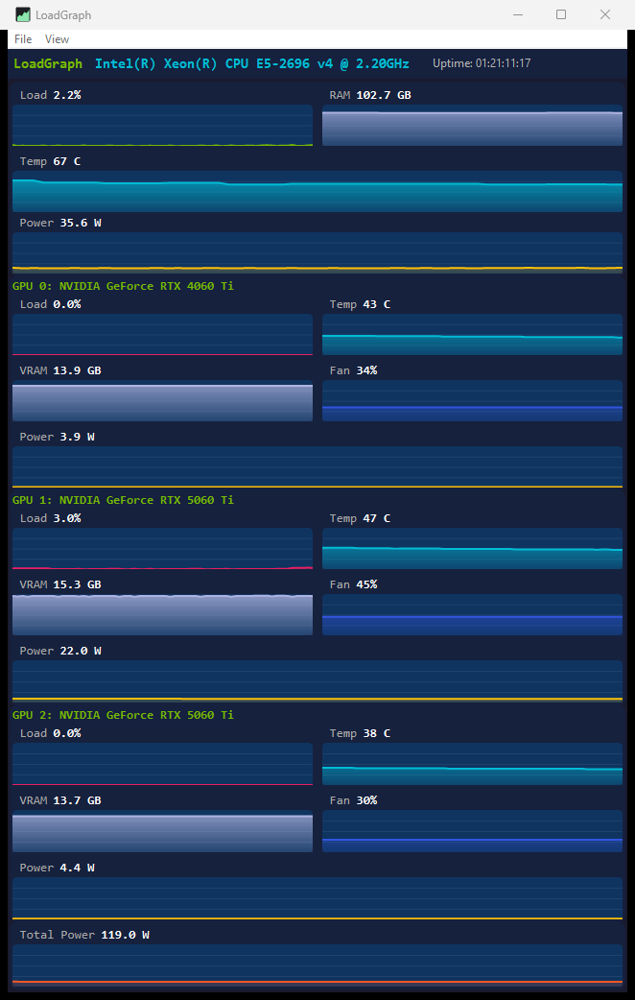
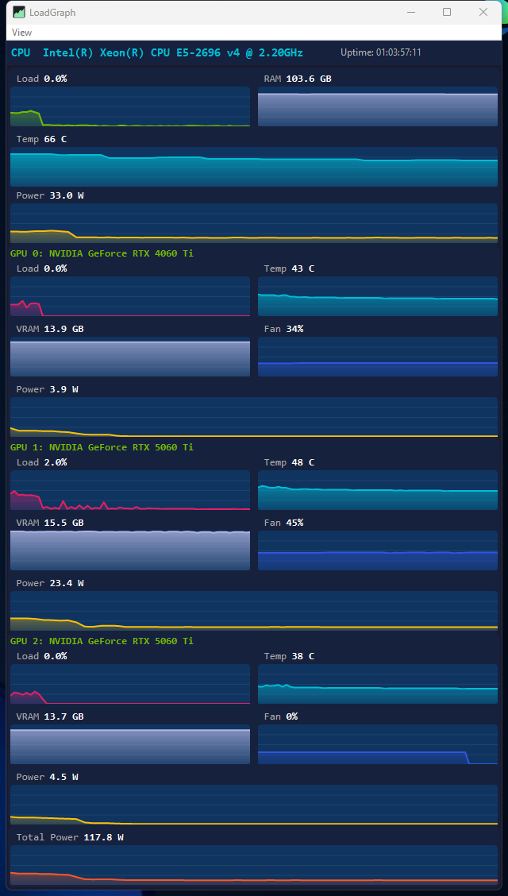
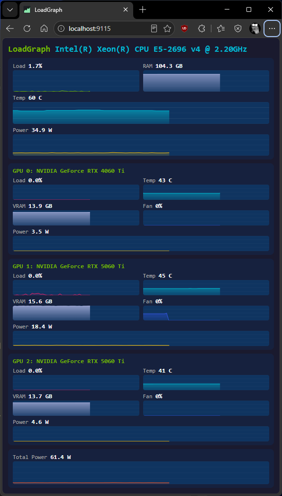
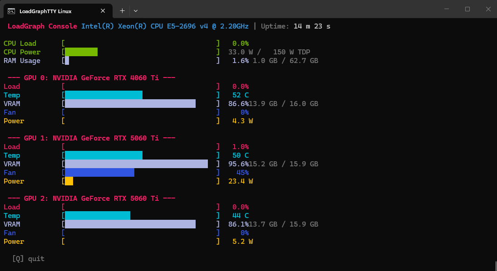
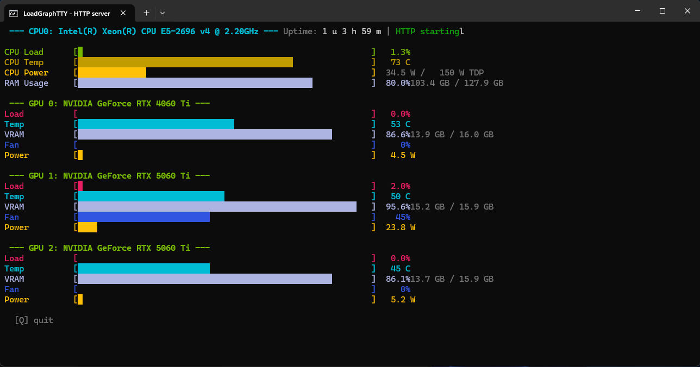

# LoadGraph

Монитор системных ресурсов в реальном времени, созданный для визуального контроля локальных LLM-нагрузок. Windows 7 SP1/8.1/10/11 + Linux (Ubuntu 22.04 / Linux Mint). Одна диаграмма на метрику, одно окно, без вкладок и полосы прокрутки.

[English version](README.md)

**Версия:** 1.0.0

## Скачать

Предсобранный 64-битный Windows-бинарь доступен по адресу [andyk.ru/files/LoadGraph.zip](https://andyk.ru/files/LoadGraph.zip). Распакуйте и запустите `LoadGraph.exe` (сборка даёт `build\bin\Release\LoadGraphGUI.exe`) — установка не требуется. Бинарь самодостаточен: Си-рантайм слинкован статически, поэтому устанавливать "Visual C++ Redistributable" не нужно и рядом с исполняемым файлом ничего не размещается. Для мониторинга температуры CPU поместите совместимый с WinRing0 файл `.sys` рядом с исполняемым (см. [Драйвер](#драйвер)).

> **Примечание для Windows 7:** x64-сборка работает на Windows 7 SP1 и новее. Windows 7 RTM (без пакета обновлений) не поддерживается, а консольная версия (`LoadGraphTTY`) полагается на ANSI escape-последовательности, которые консоль Windows 7 не понимает — там используйте GUI.

## Зачем это нужно

Стандартные утилиты мониторинга GPU не подходят, когда нужно одновременно следить за несколькими картами — а именно такая ситуация возникает при запуске локальных LLM:

| Утилита | Проблема |
|---|---|
| **Диспетчер задач Windows** | Показывает только первую GPU. На второй карте значение GPU Load неверное.|
| **NVIDIA App** | Отдельная вкладка на каждую GPU. Нельзя видеть все карты одновременно. |
| **nvidia-smi** | Консольный текст. Годится для скриптов, бесполезен для визуального мониторинга LLM-инференса. |
| **HWInfo / MSI Afterburner** | Тяжёлые утилиты с шумом. Оверлей Afterburner перекрывает окно с LLM. |

LoadGraph решает эту проблему: **все метрики всех GPU видны одновременно в одном окне**, вместе с CPU и RAM. Полная картина, без переключения.

## Что показывает

- **Шапка** — модель процессора слева и время работы системы справа (такая же шапка в веб-дашборде)
- **CPU Load (%)** — общая загрузка процессора (дельта-метод `/proc/stat` на Linux, PDH `\\Processor(_Total)\\% Processor Time` на Windows)
- **RAM Usage (GB)** — использованная память с адаптивной осью Y
- **GPU Load (%)** — загрузка каждой GPU (один раздел на каждую обнаруженную карту NVIDIA или AMD, заголовок раздела — название модели; каждый раздел содержит графики Load, VRAM, Temperature, Fan и Power)
- **VRAM (GB)** — объём видеопамяти на каждой карте
- **Temperature (°C)** — температура GPU; температура CPU на Windows через MSR (IA32_THERM_STATUS 0x19C, Tjmax по семейству: 84 для Haswell-E/EP, 85 для Broadwell-EP, 100 для Skylake и новее); красная линия тревоги выше 80°C
- **Fan (% / RPM)** — скорость вентилятора GPU в процентах (или fallback в RPM), вентилятор CPU в RPM (когда датчик доступен)
- **GPU Power (W)** — энергопотребление каждой карты (NVIDIA: NVML `nvmlDeviceGetPowerUsage`; AMD: ADL2 Overdrive6 на Windows, hwmon `power1_average` на Linux)
- **CPU Power (W)** — реальный счётчик RAPL на Linux, или WMI-сенсор LHM/OpenHardwareMonitor на Windows, или оценка idle-floor как последний резерв
- **Total Power (W)** — сумма CPU + всех GPU; фиксированная шкала 0..1000 W с 5 делениями
- **Uptime** — время работы системы с момента загрузки, отображается как `YY:MM:DD HH:MI:SS` или `<N> s` для свежих перезагрузок

## Скриншоты

### Windows



### Linux / WSL2

Работает на нативном Linux и внутри WSL2 благодаря GPU-PV bridge (NVML доступен по `/usr/lib/wsl/lib/libnvidia-ml.so.1`). NVAPI — только для Windows; на Linux используется исключительно NVML. AMD-карты на Linux читаются напрямую из драйвера `amdgpu` — sysfs (`gpu_busy_percent`, `mem_info_vram_*`) и hwmon (`temp1_input`, `power1_average`, `fan1_input`, `freq1_input`) — без внешних утилит и библиотек ROCm.



### Веб-дашборд (HTTP-сервер)

Включите `"http_enabled": true` в `loadgraph.cfg` или переключайте на ходу через **File -> HTTP server (port N)** (`Ctrl+H`) в GUI — выбор сохраняется в `loadgraph.cfg`. Сервер запускается на заданном порту (по умолчанию `9115`) в отдельном потоке:

- **`GET /`** — адаптивный HTML-дашборд с живыми графиками, повторяет компоновку GUI. Чистый vanilla JS + Canvas, без зависимостей.
- **`GET /api/metrics`** — JSON-эндпоинт со всеми текущими метриками (CPU загрузка/температура/мощность, RAM, данные по каждой GPU, накопители).
- **`GET /favicon.ico`** — встроенный фавикон.

Все эндпоинты защищены **HTTP Basic auth**. Логин и пароль задаются в `loadgraph.cfg` (`"http_user": "load"`, `"http_pass": "graph"` — значения по умолчанию `load` / `graph`). При первом открытии браузер запросит учётные данные; чтобы обходиться без логина, поставьте `"http_auth": false` (или `"http_user": ""`). Пароль читается при запуске сервера — после его изменения перезапустите сервер (переключатель `Ctrl+H` или перезапуск приложения). Пароль хранится в конфиге в открытом виде, поэтому защищайте файл правами доступа пользователя.

В отдельный лог доступа `loadgraph_http.log` (тот же каталог пользователя) пишутся **только невалидные запросы**: соединения без байтов запроса (порт-сканеры), отказы `401` и неизвестные пути `404`. Файл создаётся лениво — только при первом записанном событии, — и никогда не перезаписывается: при перезапусках события дописываются в конец. Каждая строка содержит `IP:порт` клиента, метод, путь, код ответа и сырой текст запроса одной строкой (управляющие байты экранированы, длина ограничена, заголовок `Authorization` маскируется как `***`). Валидные ответы — включая секундные опросы `/api/metrics` из дашборда — не логируются, поэтому в обычном режиме файл даже не создаётся. Отключается параметром `"http_log": false`.

Работает на Windows и Linux. Дашборд обновляется каждую секунду через polling.



## Консольное приложение (LoadGraphTTY)

Утилита для терминала — нулевая зависимость от wxWidgets, работает в любом UTF-8-терминале.

```
LoadGraphTTY [-port N]
  -port N   Запустить встроенный HTTP-сервер на порту N (отдаёт веб-дашборд)
  -h        Показать справку
```

Возможности:

- **Компоновка в стиле htop** — CPU Load и RAM Usage с горизонтальными прогрессбарами (ширина масштабируется от ширины консоли, 20..60 ячеек)
- **Метрики каждой GPU** — Load, Temperature (цветовая индикация: зелёный/жёлтый/красный), VRAM, Fan, Power
- **Цветной вывод** — читает цвета из `loadgraph.cfg`; Windows использует WinAPI console colors, Linux — ANSI-последовательности
- **UTF-8 прогрессбары** — `█` block character для заполненной части, обычные пробелы для пустой, на обеих платформах
- **Опциональный HTTP-сервер** — передайте `-port 9115` для запуска веб-дашборда параллельно с TTY
- **Файловый лог** — пишет снимки `loadgraph.jsonl` в каталог конфигурации при `"log_file": true` в конфиге (раз в 5 с; файл пересоздаётся на каждом запуске, снимки прошлого сеанса отбрасываются)

### Скриншоты

#### Linux / WSL2



#### Windows



## Требования

### Windows

- Visual Studio 2022 (MSVC) — обязателен на Windows (используются SEH-расширения и флаги компилятора MSVC; MinGW не поддерживается)
- wxWidgets 3.2 статическая сборка со статическим CRT (`C:/wxWidgets`, собирается в `build_static_mt`, см. [Сборка](#сборка)). Переопределить: `-DWX_WIN_BUILD_DIR=<каталог lib>` и `-DWX_CONFIG_PATH=<корень>`
- Драйвер NVIDIA (для метрик GPU; CPU/RAM работают без GPU)
- Для метрик AMD GPU нужен установленный драйвер AMD (Adrenalin или старый Catalyst) — `atiadlxx.dll` / `atiadlxy.dll` загружается динамически, дополнительная настройка не требуется. Если ADL не перечисляет адаптер, резервный путь через DXGI всё равно показывает модель и объём VRAM (см. [Известные ограничения](#известные-ограничения))
- **Температура CPU** требует одного из:
  - Ядерного драйвера, совместимого с WinRing0 (`.sys`), размещённого рядом с исполняемым файлом — см. [Драйвер](#драйвер) ниже
  - Или прямого доступа `rdmsr` (работает на некоторых системах, где HVCI / Integrity памяти выключен и CPU не блокирует пользовательское чтение MSR)

### Linux

- gcc 13+ или clang
- wxWidgets 3.2: `sudo apt install libwxgtk3.2-dev` (или установите `$WX_CONFIG`, либо укажите `$WXSTATIC_ROOT` на собственную статическую сборку — см. [Сборка](#сборка))
- Драйвер NVIDIA + `libnvidia-ml` для метрик GPU (`nvidia-smi` должен работать)
- WSL2: GPU-PV bridge автоматически предоставляет NVML, дополнительная настройка не нужна
- AMD GPU: драйвер `amdgpu` должен показывать карту в `/sys/class/drm` (нативный Linux с видимой картой; обычный WSL2 не показывает AMD-карты, если не настроен GPU partitioning/passthrough). Названия моделей карт, привязанных к старому драйверу `radeon`, читаются из дистрибутивной базы `pci.ids` (`/usr/share/misc/pci.ids` из пакета `pciutils` или `/usr/share/hwdata/pci.ids` из `hwdata`)

## Драйвер

Температура CPU на Windows считывается из IA32_THERM_STATUS (MSR 0x19C). Для этого требуется драйвер ядра, потому что пользовательский `rdmsr` по умолчанию заблокирован на современных процессорах Intel.

### Распространение драйвера

Перед распространением поместите файл `.sys`, совместимый с WinRing0, рядом с исполняемым файлом. Поддерживаемые имена (проверяются по порядку):

```
hwinterfacex64.sys
inpoutx64.sys
WinRing0x64.sys
```

Приложение также обнаружит любую из трёх уже зарегистрированных известных служб и использует их без необходимости в `.sys`-файле: `WinRing0_1_2_0` (RealTemp / LibreHardwareMonitor), `hwinterfacex64` или `inpoutx64`.

### Установка драйвера через UAC

Если бэкенд недоступен, но `.sys`-файл присутствует, LoadGraph показывает однократный запрос:

> «Установить ядерный драйвер для мониторинга температуры CPU?»

Принятие запроса повышает привилегии процесса через `ShellExecute(runas)`, запускает встроенную вспомогательную программу (`--install-driver`), которая регистрирует и запускает службу — оставляя её установленной. При типе `SERVICE_DEMAND_START` служба сохраняется в рамках текущей сессии без дополнительных запросов UAC, но первый запуск после перезагрузки снова потребует повышения привилегий. Установите службе `AUTO_START`, если хотите автоматическую загрузку при старте системы. Отказ или отмена gracefully переключает на WMI / N/A для температуры.

> **Примечание:** WinRing0 находится в списке уязвимых драйверов Microsoft. Windows Defender может автоматически удалить `.sys`-файл. Если это произойдёт, добавьте исключение для директории с LoadGraph в Параметры защиты Windows → Защита от вирусов и угроз → Управление настройками → Исключения. Это тот же обходной путь, который используют сообщества RealTemp и HWiNFO.

### Прямой fallback на rdmsr

На системах, где HVCI / Integrity памяти выключен и CPU не блокирует пользовательский доступ к MSR, LoadGraph использует `__readmsr()` без какого-либо драйвера. Температура будет показана корректно. Если встроенная функция вызовет исключение (нарушение привилегий), приложение молча переключится на WMI.

## Сборка

### Windows (MSVC)

LoadGraph линкует Си-рантайм статически (`/MT`), поэтому **все** статические библиотеки,
которые в него входят, должны быть собраны со статическим CRT — включая wxWidgets. Смешивание
`/MT`-объектов с `/MD`-библиотеками добавило бы в процесс вторую копию CRT (две кучи, два
состояния locale) и снова вернуло бы зависимость от `VCRUNTIME140.dll`. Соберите библиотеки wx
один раз так:

```powershell
cmake -S C:\wxWidgets -B C:\wxWidgets\build_static_mt -G "Visual Studio 17 2022" -A x64 `
      -DBUILD_SHARED_LIBS=OFF -DCMAKE_MSVC_RUNTIME_LIBRARY=MultiThreaded
cmake --build C:\wxWidgets\build_static_mt --config Release `
      --target wxbase wxcore wxpng wxjpeg wxtiff wxzlib wxregex
```

Затем соберите приложение:

```powershell
cd build
cmake .. -G "Visual Studio 17 2022" -A x64
cmake --build . --config Release
.\bin\Release\LoadGraphGUI.exe
```

`CMakeLists.txt` берёт библиотеки из `C:\wxWidgets\build_static_mt\lib\vc_x64_lib`
(переопределяется через `-DWX_WIN_BUILD_DIR=<каталог>` и `-DWX_CONFIG_PATH=<корень>`) и
останавливается с подсказкой выполнить команды выше, если их нет. Для GUI поддерживается
только `Release`: для `Debug` нужны debug-библиотеки wx (`wxmsw32ud_core.lib` и т.д.),
которые команды выше не создают.

Windows-цели фиксируют `_WIN32_WINNT=0x0601` и линкуются с `/SUBSYSTEM:WINDOWS,6.01` /
`/SUBSYSTEM:CONSOLE,6.01`, поэтому заголовки SDK не дают использовать API новее Windows 7,
а заголовок PE объявляет Windows 7 минимальной ОС.

### Linux

```bash
mkdir -p build_linux && cd build_linux
cmake ..
make -j$(nproc)
./bin/LoadGraphGUI
```

Переопределить путь к wx-config:

```bash
WX_CONFIG=/opt/wx/3.2/bin/wx-config cmake ..
```

Вместо пакетной сборки можно использовать собственную статическую сборку wxWidgets
(именно так собран вариант для WSL2, потому что пакет Ubuntu `libwxgtk3.0-1` собран
без `wxUSE_GRAPHICS_CONTEXT`, и `graph_panel.cpp` против него не компилируется).
Переменная `WXSTATIC_ROOT` читается из окружения и должна указывать на каталог с
`include/`, `include/gtk3-unicode-static-3.2/` и архивами `libwx_*-3.2.a`:

```bash
WXSTATIC_ROOT=$HOME/wxstatic cmake ..
```

`WXSTATIC_ROOT` имеет приоритет над `wx-config`, и при её установке из кэша CMake
явно удаляется устаревшая запись `WX_CONFIG_EXECUTABLE` — без этого повторный `cmake`
после правки `CMakeLists.txt` незаметно вернул бы сборку на заголовки системного wx.

## Конфигурация

Все настройки хранятся в одном файле `loadgraph.cfg` формата JSON, в одном и том же пользовательском каталоге на обеих платформах (создаётся при первом запуске):

- **Windows**: `%USERPROFILE%\.config\loadgraph\loadgraph.cfg`
- **Linux**: `$XDG_CONFIG_HOME/loadgraph/loadgraph.cfg` (по умолчанию `~/.config/loadgraph/loadgraph.cfg`)

`loadgraph.log` (GUI) и `loadgraph.jsonl` (консольная версия) пишутся в тот же каталог — рядом с исполняемым файлом ничего не размещается. Оба файла пересоздаются при каждом запуске: содержимое предыдущего сеанса отбрасывается. При запущенном HTTP-сервере с `"http_log": true` туда же пишется `loadgraph_http.log` (лог доступа: IP клиентов, тексты невалидных запросов).

```jsonc
{
  "http_port": 9115,
  "http_enabled": false,
  "http_user": "load",
  "http_pass": "graph",
  "http_auth": true,
  "http_log": true,
  "log_file": false,
  // Позиция и размер окна — (0,0,0,0 = дать ОС решить)
  "window_x": 100,
  "window_y": 100,
  "window_w": 640,
  "window_h": 720,
  "colors": {
    "cpu_load": "76B900", "cpu_temp": "00bcd4", "cpu_power": "ffc107",
    "ram": "AEB4E1", "gpu_load": "e91e63", "gpu_temp": "00bcd4",
    "gpu_vram": "AEB4E1", "gpu_fan": "3154E1", "gpu_power": "ffc107",
    "total_power": "ff5722"
  },
  "backgrounds": {
    "page": "1a1a2e", "section": "16213e", "chart": "0f3460"
  },
  // Состояние видимости меню View (сохраняется между сессиями)
  "view_menu": { "cpu_load": true, "ram": true, "gpu_temp": false, ... }
}
```

## Архитектура

```
src/
  main.cpp                  # точка входа, платформенные guards, обработчик SIGSEGV (Linux),
                            # режим elevated helper (--install-driver), размещение crash.log
  console_app.cpp           # LoadGraphTTY — htop-like терминальный UI + опциональный HTTP-сервер
  main_frame.{h,cpp}        # окно: заголовок + пропорционально растянутые строки графиков,
                            # переключение через меню View
  graph_panel.{h,cpp}       # пользовательский wxPanel, отрисовка через wxGraphicsContext
  metrics_collector.{h,cpp} # базовый класс: поток опроса, интервал 1000 мс, остановка через
                            # condition_variable
  cpu_monitor.{h,cpp}       # Windows — PDH загрузка, WMI-зонд температуры, инициализация MSR,
                            # LHM/WMI сенсор мощности
  cpu_monitor_linux.cpp     # Linux — /proc/stat (дельта-метод), /sys/class/thermal, RAPL мощность
  ram_monitor.{h,cpp}       # Windows — GlobalMemoryStatusEx
  ram_monitor_linux.cpp     # Linux — /proc/meminfo
  gpu_monitor.{h,cpp}       # Windows — NVML основной + NVAPI fallback (GetDynamicPstates)
  gpu_monitor_linux.cpp     # Linux — dlopen libnvidia-ml.so.1 (реальные имена символов)
  amd_monitor.{h,cpp}       # AMD GPU — ADL2 (динамическая atiadlxx.dll) + DXGI VRAM на Windows, amdgpu sysfs/hwmon на Linux
  ring0_msr.{h,cpp}         # WinRing0 DLL / ядерный драйвер бэкенд, помощники повышения UAC
  msr_sensor.{h,cpp}        # считыватель температуры MSR: декодирование Tjmax, запрос EnsureDriver
  power_table.{h,cpp}       # статическая таблица TDP для CPU Intel/AMD и GPU NVIDIA (match по подстроке)
  theme.{h,cpp}             # Windows — Registry AppsUseLightTheme, кэш тёмной палитры
  theme_linux.cpp           # Linux — GTK_THEME, XDG_CURRENT_DESKTOP, кэш gsettings на 30 с
  app_config.h/cpp          # структура AppConfig + парсер/эмиттер JSON для loadgraph.cfg
  http_server.{h,cpp}       # кроссплатформенный HTTP-сервер + HTML веб-дашборд
  logger.{h,cpp}            # файловый логгер (loadgraph.log в пользовательском каталоге конфигурации, пересоздаётся при каждом запуске; при ошибке fopen — вывод в stderr)
  platform.h                # PLATFORM_WINDOWS / PLATFORM_LINUX, ReadFileToString, помощник mkdir -p
```

### Ключевые архитектурные решения

- **MetricsCollector** использует `condition_variable` для остановки — поток завершается за миллисекунды, а не за секунды.
- **SEH-защита** вокруг вызовов `rdmsr` и WMI предотвращает падения на системах, где эти API ведут себя нестабильно.
- **Единый файл конфигурации**: позиция/размер окна, состояние меню View, цвета, настройки HTTP — всё в одном `loadgraph.cfg`. Никаких отдельных файлов.
- **Жизненный цикл драйвера**: `Open()` сначала пробует DLL, затем ядерное устройство, затем известную службу, затем регистрирует из `.sys`. `Close()` *не* останавливает и не удаляет службы — драйвер остаётся установленным между запусками (служба типа DEMAND_START сохраняется без необходимости повторной установки; сам драйвер загружается при первом использовании).
- **Повышение UAC** выполняется однократно: вспомогательный процесс устанавливает/запускает службу и завершается; последующие запуски без повышения используют уже запущенную службу.
- **Таблица TDP GPU** сопоставляет по подстроке, причём более длинные шаблоны идут раньше (например, `"RTX A4000"` перед `"A40"`), чтобы избежать перекрытия.

## Известные ограничения

- **AMD GPU (Windows)** — метрики берутся из ADL2 (`atiadlxx.dll` / `atiadlxy.dll`, динамическая загрузка): загрузка и частоты из `ADL2_Overdrive6_CurrentStatus_Get`, резервный источник — `ADL2_Overdrive5_CurrentActivity_Get`; температура (OD6, затем OD5), вентилятор (проценты и RPM) и объём VRAM (`ADL2_Adapter_MemoryInfo2_Get`); использованный VRAM всегда берётся из DXGI (`IDXGIAdapter3::QueryVideoMemoryInfo`) — он же единственный источник VRAM, если ADL не отдаёт данные о памяти. Энергопотребление читается из `ADL2_Overdrive6_CurrentPower_Get` и остаётся N/A на драйверах без этой функции — типично для старых Catalyst и карт до GCN. Лимит мощности в Ваттах через ADL не доступен, поэтому у AMD на Windows он всегда N/A. Одна физическая карта показывается один раз, хотя ADL выдаёт отдельную запись на каждый дисплейный выход (8-выходная R9 280 даёт 8 записей с одним и тем же адресом bus/device/function). Если ADL вообще не перечисляет адаптер, резервный путь через DXGI (`IDXGIAdapter3::QueryVideoMemoryInfo`) всё равно показывает модель и VRAM, остальное — N/A. Startup-лог снимает вопросы о ненайденной карте: `DIAG OS display ...` перечисляет то, что видит ОС (`EnumDisplayDevicesA`), `DIAG ADL[...]` — каждую запись ADL с vendor id, адресом на шине и флагами `iPresent`/`iExist`, а строки `AMD: ...` сообщают, сколько физических адаптеров распознано и какой источник используется.
- **AMD GPU (Linux/WSL2)** — читается из sysfs/hwmon драйвера `amdgpu` (`gpu_busy_percent`, `mem_info_vram_*`, `temp1_input`, `power1_average`, `power1_cap`, `fan1_input`, `pwm1`, `freq1_input`). Карта должна быть видна Linux: в WSL2 нужен GPU partitioning/passthrough, обычный WSL2 показывает только NVIDIA vGPU bridge. Картам на старом драйвере `radeon` (TeraScale, GCN1) доступно лишь то, что `radeon_pm.c` регистрирует в hwmon: температура (`temp1_input` в миллиградусах), ШИМ вентилятора (`pwm1`/`pwm1_max`, диапазон 0..255, пересчитывается в проценты) и частота GPU (`freq1_input`, сразу в Гц); RPM вентилятора, VRAM, мощность и загрузка этим драйвером не экспортируются вовсе и остаются N/A. Там название модели берётся из дистрибутивной базы `pci.ids`, потому что `product_name`/`pretty_name` — специфичные для amdgpu файлы. Карты SI (например Tahiti / R9 280) можно перевести на `amdgpu` параметрами ядра `radeon.si_support=0 amdgpu.si_support=1` (нужна прошивка SI), что без всяких изменений в коде открывает загрузку, VRAM и мощность. Startup-лог печатает блок `AMD diag:` с именем драйвера, PCI ID и всеми реально присутствующими файлами сенсоров.
- **Intel GPU** — не поддерживаются.
- **macOS** — не является целевой платформой.
- **Температура CPU на Linux** — читается из `/sys/class/thermal/thermal_zone0/temp`; на многих настольных платах тепловая зона отсутствует, поэтому N/A — обычное дело.
- **HVCI / Integrity памяти** — если включён в Параметрах защиты Windows, пользовательский `rdmsr` заблокирован и требуется ядерный драйвер.
- **Список WinRing0** — Microsoft активно блокирует драйверы WinRing0 на Windows 11 22H2+. Defender может удалить `.sys`-файл; при необходимости добавьте исключение для директории LoadGraph.
- **Виртуализированные системы (Hyper-V / VM)** — температура CPU обычно показывает N/A. Стандартные WMI-классы тепловых зон (`MSAcpi_ThermalZoneTemperature`) недоступны из пользовательского режима гостевой ОС, а `rdmsr` блокируется гипервизором. NVIDIA App обходит это, запуская свой бэкенд (`nvcontainer.exe`) от имени LOCALSYSTEM, который имеет другие WMI-разрешения — воспроизведение этого паттерна требует повышения привилегий.

## Лицензия

MIT
